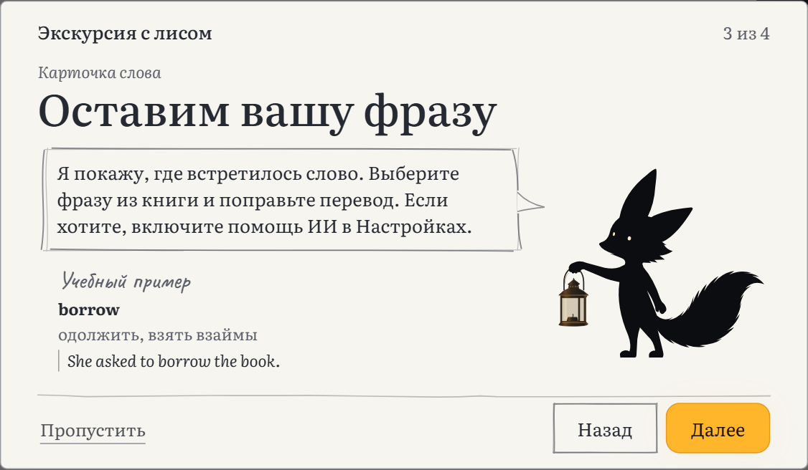
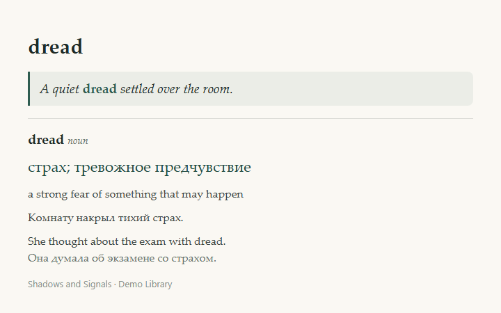

# Kindle Cards

Kindle Cards собирает английские слова, которые вы искали на читалке, и превращает их в карточки с русским переводом. Если читалка сохранила предложение, оно тоже попадёт в карточку. Так фраза *they sat on the river bank* напомнит, какой именно перевод слова *bank* нужен в этой книге.

В кандидате **Kindle Cards 1.0 для Windows x64** лис с фонарём встречает читателя на Главной. Он покажет, как загрузить слова, с каких начать и как взять с собой удачную фразу из книги. На снимках использованы учебные данные. В заголовке окна кандидата указано «Kindle Cards 1.0». [Как проверить 1.0 со своей читалкой](docs/releases/1.0.0-rc1.md).

## Как начать

Нужен компьютер с Windows 10 или 11.

**1. Установите свою версию.** Для закрытой проверки 1.0 используйте установщик, переданный вместе с кандидатом. Публично доступна [Kindle Cards 0.4.0 для Windows x64](https://github.com/Rescue5/kindle-anki-cards/releases/download/v0.4.0/Kindle.Cards_0.4.0_x64-setup.exe). Установка доступна без прав администратора.

[Что изменилось в 0.4.0](docs/releases/0.4.0.md)

Установщик 0.4.0 поставляется без цифровой подписи. Если Windows покажет окно SmartScreen, сверить файл можно по SHA-256 в заметках к версии. Для запуска проверенного файла:

1. Нажмите «Подробнее» (маленькая надпись в окне).
2. Нажмите появившуюся кнопку «Выполнить в любом случае».

**2. Загрузите слова.** Подключите читалку кабелем USB с передачей данных. Если устройство предложит выбрать режим USB, включите передачу файлов. На главной нажмите «Загрузить слова с читалки» или «Выбрать файл». Пути к файлам перечислены ниже. «Посмотреть на примере» открывает демонстрацию без читалки.

**3. Проверьте подборку и выгрузите карточки.** На Главной видно, сколько слов уйдёт в выгрузку. Если открыт Anki с дополнением AnkiConnect, карточки появятся в колоде. Иначе приложение сохранит файл `.apkg`. Нажмите «Открыть в Anki» и подтвердите импорт. Чтобы вернуться к файлу позже, нажмите «Открыть папку выгрузок» на Главной.

Читалка может быть Kindle (включая новые модели), PocketBook, Kobo или Boox. PocketBook и Boox подходят, если вы читаете в KOReader; у Kobo подойдёт и встроенный словарь. Телефонное приложение Kindle не подходит.

### Знакомство с лисом во внутренней сборке

При первом открытии с пустой библиотекой лис проводит короткую экскурсию. На четырёх шагах вы увидите, как загрузить слова с читалки или из файла, найти слово по приоритету, выбрать перевод и цитату для карточки, а затем выгрузить подборку. Можно пройти экскурсию без читалки.

Нажмите **«Пропустить»** или **Esc** на любом шаге, чтобы сразу перейти к работе. Чтобы пройти экскурсию ещё раз, откройте **Настройки → Пройти обучение с лисом**. Этот же пункт доступен после обновления с уже заполненной библиотекой.

### Как проверить переводы из книг

В новой внутренней версии откройте **Настройки → Перевод через ИИ**, выберите провайдера и модель, затем нажмите **«Выбрать слова для перевода»**. В библиотеке действие **«Перевести с ИИ»** находится над списком. Чтобы проверить, например, уровни 8, 9 и 10, отметьте их в фильтре приоритетов. Перед запуском можно просмотреть все слова, которые получит модель.

В карточке под книжной цитатой показано, какое значение подходит в этом предложении. Если отрывок короткий или неоднозначный, ИИ может предложить отдельный пример с переводом. В Настройках можно включить **«Пример для каждого значения»**. Свой перевод по-прежнему можно ввести вручную.

«Не учить» скрывает слово из обычного списка. Его можно найти через фильтр решения. **«Последнее пополнение»** показывает слова из последней загрузки, которая добавила их в библиотеку; пустая повторная загрузка сохраняет этот список. Для просмотра в обратной хронологии выберите **«По дате добавления»**.

### Куда выгружать карточки во внутренней сборке

На экране «Настройки» выберите место выгрузки. На Главной можно взять всю библиотеку, отдельные уровни приоритета или порцию новых слов.

- **Obsidian · Spaced Repetition.** Укажите корневую папку существующего хранилища и запустите выгрузку на Главной. Внутри появится папка `Kindle Cards` с отдельной заметкой на слово. Во включённом Spaced Repetition откройте список колод. При стандартных настройках внутри `flashcards → kindle-cards` появятся уровни с выгруженными словами. В режиме колод по папкам откройте `Kindle Cards` и нужный уровень. Если плагин отключён, заметки уже доступны, а приложение подскажет, как включить повторение. [Как плагин определяет колоды](https://www.stephenmwangi.com/obsidian-spaced-repetition/flashcards/decks/)
- **Повтор в Obsidian.** Kindle Cards узнаёт свою заметку при повторной выгрузке. Перевод из приложения можно обновить с сохранением поддерживаемых меток расписания. Если вы отредактировали текст в Obsidian, приложение сохранит вашу версию и укажет число конфликтов. Снятый приоритет исключает слова из текущей выгрузки. Ранее созданные заметки остаются в хранилище.
- **Quizlet.** Откройте полученный TSV, скопируйте содержимое в форму импорта нового набора в веб-версии Quizlet. Между словом и ответом выберите табуляцию, между карточками — новую строку. [Импорт в Quizlet](https://help.quizlet.com/hc/en-us/articles/360029977151-Creating-sets-by-importing-content)
- **RemNote.** Скопируйте текст из полученного TXT в документ RemNote. Каждая строка даёт одну прямую карточку «слово → ответ». [Импорт текста в RemNote](https://help.remnote.com/en/articles/9252072-how-to-import-flashcards-from-text)
- **Anki** отправляет колоду через AnkiConnect или сохраняет файл `.apkg`. **Подробный TSV** сохраняет таблицу с переводами, цитатами и другими полями для самостоятельного импорта.

## Без провода: где лежит файл со словами

Если читалка не определилась или вы не хотите её подключать, скопируйте файл со словами себе на компьютер и выберите его в приложении. Повторный выбор того же файла дублей не создаёт.

- **Kindle:** `system/vocabulary/vocab.db` на диске читалки.
- **PocketBook, Kobo, Boox с KOReader:** `vocabulary_builder.sqlite3` в папке настроек KOReader: на PocketBook — `applications/koreader/settings`, на Kobo — `.adds/koreader/settings`, на остальных — `koreader/settings`. KOReader — бесплатная программа для чтения, которую ставят на эти читалки вместо или рядом с родной; слова, которые вы в ней искали, она сама собирает в этот файл.
- **Kobo со встроенным словарём:** `KoboReader.sqlite` в скрытой папке `.kobo` на диске читалки. Предупреждение: Kobo не сохраняет предложение из книги, поэтому без KOReader в карточке будет только слово.

## Что попадает в карточку Anki

- На лицевой стороне предложение из вашей книги, слово в нём выделено.
- На обороте: словарная форма слова, часть речи, русский перевод, английское определение, пример и название книги.
- Перевод берётся из встроенного словаря на основе Викисловаря (около 57 тысяч слов и фразовых глаголов). Если у вас есть свой ключ ИИ или локальная модель, можно по желанию уточнить перевод до значения, в котором слово стоит в вашем предложении. Это необязательно.

## Что приложение уже делает со списком

В версии 0.4.0 Главная предлагает короткую подборку. Её размер можно изменить в настройках. Уже выгруженные слова уходят из подборки.

Во внутренней сборке на Главной по умолчанию выбрана **«Вся библиотека»**. На кнопке видны количество слов и место выгрузки. Перед выгрузкой можно снять отдельные приоритеты. Ещё можно выбрать все новые слова для изучения или указать размер порции. На Главной видны первые пять слов выбранной выгрузки. Кнопка «Найти Kindle» повторно проверяет подключение читалки.

При повторном импорте Anki узнаёт карточки Kindle Cards по постоянному идентификатору. Для существующей карточки сохраняется расписание повторений. Обновление полей зависит от настроек импорта. Перевод и пример из Kindle Cards могут заменить правки в Anki. Слова из исключённых уровней остаются в колоде.

Раздел **«Слова»** показывает всю библиотеку. Приоритет **1** означает «учить в первую очередь», **9** — низкий приоритет, **10** — возможную ошибку записи. Пока данных мало, рядом с уровнем 6 стоит пометка «предварительно». Причина оценки видна в строке слова. В карточке можно прочитать пояснение целиком и посмотреть, сколько раз и в скольких известных книгах читалка сохранила слово. Любое слово можно найти и отметить «Учить». Само решение хранится отдельно от оценки.

## Чего приложение не делает

- Не заменяет Anki: учить и повторять слова удобнее там.
- Не работает на macOS и Linux в виде установщика: пока только Windows.
- Не ищет слова в телефонном приложении Kindle.
- Не гарантирует идеальный перевод: словарный перевод может не совпасть со значением в вашей книге, а программа иногда путает формы слов. Карточку можно поправить в Anki.
- Перевод через ИИ включается в Настройках. Для проверки в новой внутренней версии модель получает номер слова в запросе, его форму и лемму, часть речи, текущий перевод и до 400 символов выбранной цитаты. После ошибки запрос может повториться. Отдельно приложение может искать обложки в Open Library по названию книги и автору при синхронизации.

Подробности — про ИИ-провайдеров, приватность, сборку из исходников и лицензии — в [docs/TECHNICAL.md](docs/TECHNICAL.md). Баги и идеи — в [Issues](https://github.com/Rescue5/kindle-anki-cards/issues).

## Лицензия

[MIT](LICENSE). Встроенный словарь — производная работа от Викисловаря под [CC BY-SA 4.0](kindle_vocab_app/data/README.md). Kindle — товарный знак Amazon; проект с Amazon не связан.

