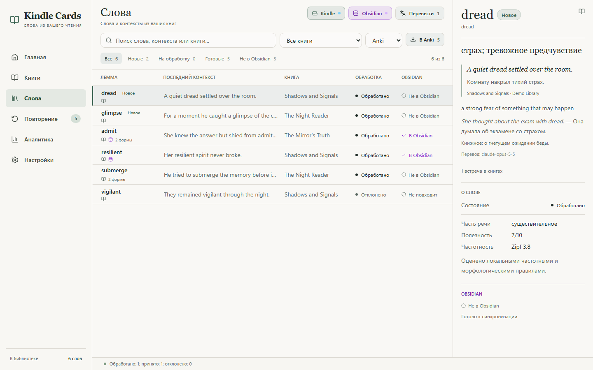
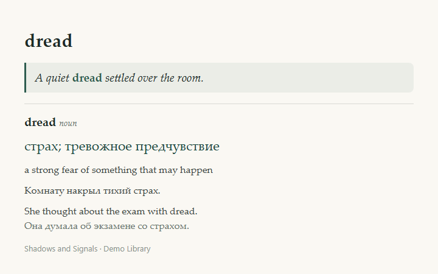
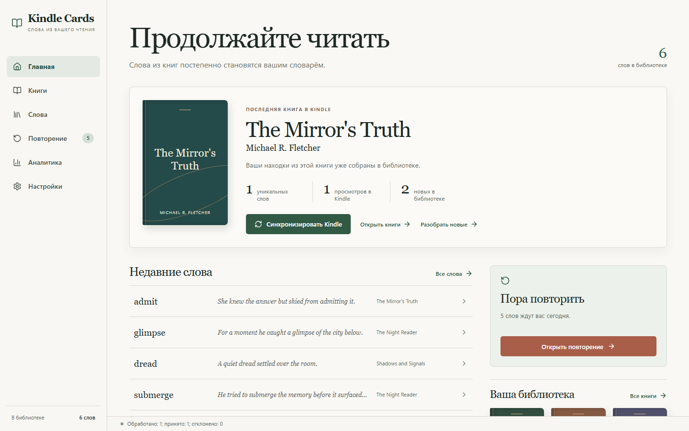
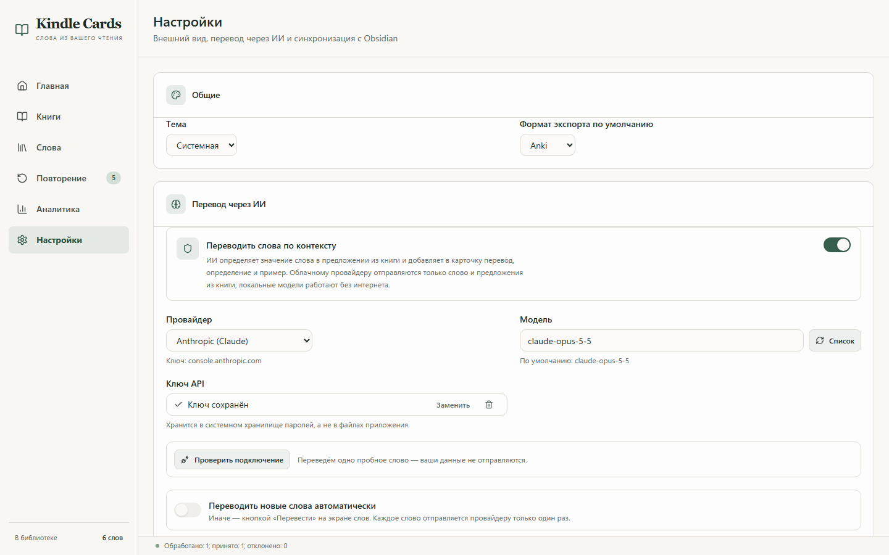

# Kindle Cards

**Слова, которые вы искали в словаре Kindle, — в карточки Anki вместе с предложением из книги.**

English: a Windows app that turns Kindle Vocabulary Builder lookups into Anki cards with the original book sentence, offline word filtering and optional AI translation of the exact sense — with your own API key or a local model. The interface is in Russian.

## Зачем

Kindle запоминает каждое слово, которое вы посмотрели в словаре, но этот список так и остаётся в устройстве. Перенести его в Anki вручную долго, а готовые экспорты дают голые слова без смысла: «bank» без «they sat on the river bank» легко выучить не в том значении.

Kindle Cards забирает слова с подключённого Kindle, отбрасывает мусор и делает карточки, где слово стоит в том самом предложении, на котором вы споткнулись. По желанию ИИ добавляет перевод именно того значения, в котором слово употреблено в книге.

## Что умеет

- **Синхронизация по USB.** Подключили Kindle — новые слова появились в библиотеке. Поддерживаются и новые модели, которые подключаются как медиаустройство (MTP). Приложение только копирует `vocab.db` и ничего не пишет на Kindle.
- **Каждое слово обрабатывается один раз.** Формы сводятся к одной лемме (`admitting` → `admit`), повторная синхронизация не создаёт дублей и не переобрабатывает старое.
- **Отсев без интернета.** Слишком простые слова, имена, опечатки и склейки отбрасываются; полезность 0–10 считается по частотности и WordNet, детерминированно.
- **Колода Anki в один клик.** Карточка: предложение из книги с выделенным словом → лемма, часть речи, перевод, определение, пример, книга. Повторный импорт обновляет карточки, а не дублирует их. С дополнением [AnkiConnect](https://ankiweb.net/shared/info/2055492159) колода уходит прямо в открытый Anki.
- **Перевод по контексту через ИИ — по желанию.** Свой ключ Anthropic, OpenAI, DeepSeek, OpenRouter или любого OpenAI-совместимого API — либо локальная модель через LM Studio / Ollama бесплатно и без интернета. Каждое слово отправляется один раз, ключ хранится в системном хранилище паролей.
- **Книги, повторение и аналитика.** Полка книг с обложками, встроенное повторение и статистика того, что вы читаете.
- **Obsidian.** Карточки для плагина Spaced Repetition, если вы учите слова там.

<table>
<tr>
<td width="50%"></td>
<td width="50%"></td>
</tr>
<tr>
<td align="center">Карточка в Anki</td>
<td align="center">Главный экран</td>
</tr>
</table>

## Установка

1. Скачайте `Kindle.Cards_…_x64-setup.exe` со страницы [последнего релиза](https://github.com/Rescue5/kindle-anki-cards/releases/latest).
2. Запустите. Установщик не подписан, поэтому Windows SmartScreen покажет предупреждение: «Подробнее» → «Выполнить в любом случае». Права администратора не нужны.
3. Подключите Kindle по USB — синхронизация начнётся сама.

Нужны Windows 10/11 и Kindle-читалка (не приложение Kindle на телефоне).

## Как пользоваться

1. **Подключите Kindle.** Слова появятся на экране «Слова» и обработаются автоматически.
2. **Включите перевод (необязательно).** «Настройки» → «Перевод через ИИ»: выберите провайдера, вставьте ключ и нажмите «Проверить подключение» — переведётся одно пробное слово, ваши данные не отправляются. Затем «Перевести» на экране слов или автоматический режим.
3. **Отправьте в Anki.** Кнопка «В Anki» собирает колоду из новых и обновлённых карточек. Без AnkiConnect нажмите «Открыть в Anki» — Anki сам предложит импорт.

## Перевод через ИИ

| Провайдер | Нужен ключ | Комментарий |
| --- | --- | --- |
| Anthropic (Claude) | да | По умолчанию `claude-opus-5-5`; модель можно сменить в настройках |
| OpenAI, DeepSeek, OpenRouter | да | Любая модель провайдера, список подгружается кнопкой «Список» |
| LM Studio, Ollama | нет | Бесплатно и без интернета; медленнее облака (9B-модель — около 12 секунд на слово) |
| Другой OpenAI-совместимый | по ситуации | Укажите адрес API и модель |

Провайдеру отправляются только слово, его словарная форма и одно-два предложения из книги. Перевод хранится локально; повторно одно и то же слово не отправляется. Без ИИ на обороте карточки будет определение из WordNet — честно помеченное как WordNet.

## Приватность

Всё хранится на вашем компьютере: библиотека — в `%APPDATA%\com.kindlevocab.cards`, ключи API — в диспетчере учётных данных Windows. Телеметрии нет. В сеть приложение ходит только к выбранному вами ИИ-провайдеру, к Open Library за обложками и к локальному Anki.

## Ограничения

- Установщик пока только для Windows. На macOS приложение работает из исходников, см. [руководство разработчика](docs/DEVELOPMENT.md).
- Офлайн-обработка рассчитана на английские книги; интерфейс на русском.
- Установщик не подписан сертификатом, отсюда предупреждение SmartScreen.
- Офлайн-лемматизация иногда ошибается: например, `felt` как прошедшее время от `feel` может остаться леммой `felt`. Перевод через ИИ учитывает контекст и в карточке это исправляет.

## Участие

Баги и идеи — в [Issues](https://github.com/Rescue5/kindle-anki-cards/issues). Как собрать и запустить из исходников, где что лежит и как собрать установщик — в [docs/DEVELOPMENT.md](docs/DEVELOPMENT.md).

## Лицензия

[MIT](LICENSE). Kindle — товарный знак Amazon; проект с Amazon не связан.
