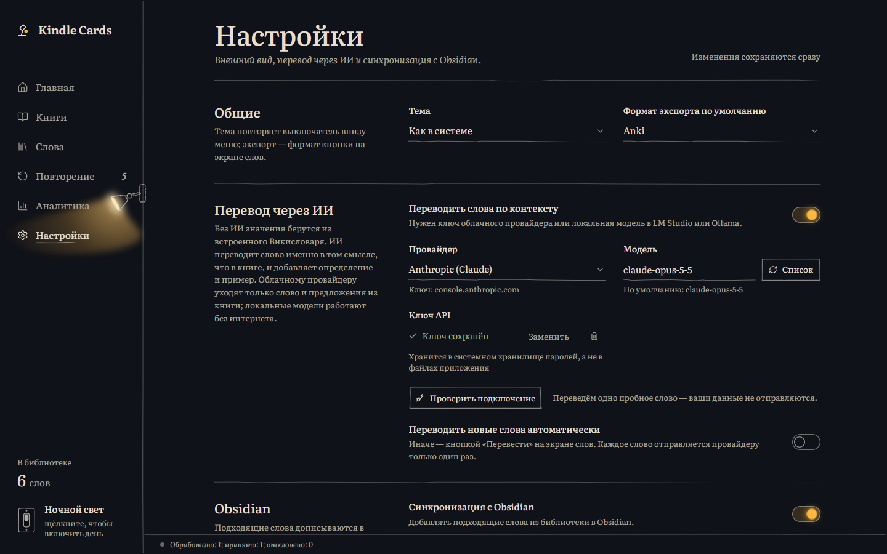

# Технические подробности

Это для тех, кто хочет знать, как приложение устроено. Чтобы просто пользоваться, хватит [README](../README.md).

## Как приложение обрабатывает слова

- Каждое слово обрабатывается один раз. Формы сводятся к одной лемме (`admitting` → `admit`), повторная синхронизация не создаёт дублей и не переобрабатывает старое.
- Отсев без интернета: слишком простые слова, имена, опечатки и склейки отбрасываются; полезность 0–10 считается по частотности и WordNet, детерминированно.
- Русский перевод без ключей и интернета: встроенный англо-русский словарь на основе Викисловаря, около 57 тысяч слов и фразовых глаголов; в реальной библиотеке читателя находится перевод для ~84% слов.
- Колода Anki: слово в предложении из книги с выделением → лемма, часть речи, перевод, определение, пример, книга. Повторный импорт обновляет карточки, а не дублирует их. С дополнением [AnkiConnect](https://ankiweb.net/shared/info/2055492159) колода уходит прямо в открытый Anki.
- Obsidian: карточки для плагина Spaced Repetition, если вы учите слова там.

## Перевод через ИИ

Необязательно. Свой ключ Anthropic, OpenAI, DeepSeek, OpenRouter или любого OpenAI-совместимого API — либо локальная модель через LM Studio / Ollama бесплатно и без интернета. Каждое слово отправляется один раз, ключ хранится в системном хранилище паролей.

Настройка: «Настройки» → «Перевод через ИИ»: выберите провайдера, вставьте ключ и нажмите «Проверить подключение» — переведётся одно пробное слово. Затем «Перевести» на экране слов или автоматический режим.

| Провайдер | Нужен ключ | Комментарий |
| --- | --- | --- |
| Anthropic (Claude) | да | По умолчанию `claude-opus-5-5`; модель можно сменить в настройках |
| OpenAI, DeepSeek, OpenRouter | да | Любая модель провайдера, список подгружается кнопкой «Список» |
| LM Studio, Ollama | нет | Бесплатно и без интернета; медленнее облака (9B-модель — около 12 секунд на слово) |
| Другой OpenAI-совместимый | по ситуации | Укажите адрес API и модель |

Провайдеру отправляются только слово, его словарная форма и одно-два предложения из книги. Перевод хранится локально; повторно одно и то же слово не отправляется. Без ИИ на обороте карточки будут значения из встроенного Викисловаря и английское определение из WordNet; ИИ заменяет словарные значения переводом именно того смысла, что в книге.

## Приватность

Всё хранится на вашем компьютере: библиотека — в `%APPDATA%\com.kindlevocab.cards`, ключи API — в диспетчере учётных данных Windows. Телеметрии нет. В сеть приложение ходит только к выбранному вами ИИ-провайдеру, к Open Library за обложками и к локальному Anki.

## Известные ограничения

- Установщик пока только для Windows. На macOS приложение работает из исходников.
- Офлайн-обработка рассчитана на английские книги; интерфейс на русском.
- Установщик не подписан сертификатом, отсюда предупреждение SmartScreen.
- Офлайн-лемматизация иногда ошибается: например, `felt` как прошедшее время от `feel` может остаться леммой `felt`. Перевод через ИИ учитывает контекст и в карточке это исправляет.

## Сборка из исходников и участие

Как собрать и запустить из исходников, где что лежит и как собрать установщик — в [DEVELOPMENT.md](DEVELOPMENT.md). Баги и идеи — в [Issues](https://github.com/Rescue5/kindle-anki-cards/issues).

## Лицензии

[MIT](../LICENSE). Встроенный словарь — производная работа от Викисловаря под [CC BY-SA 4.0](../kindle_vocab_app/data/README.md). Определения на английском берутся из WordNet. Kindle — товарный знак Amazon; проект с Amazon не связан.
